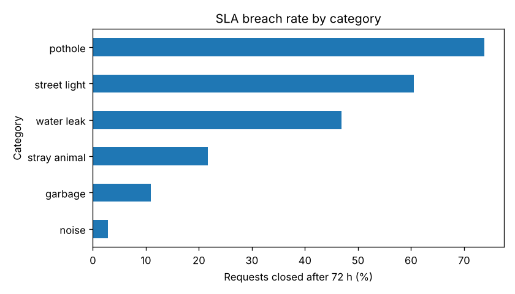
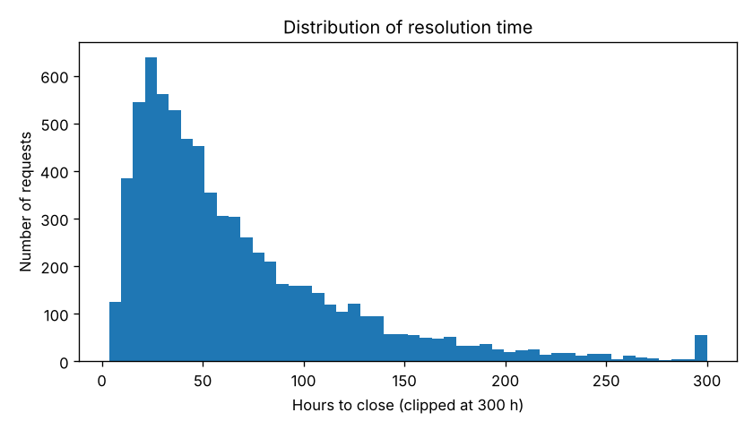
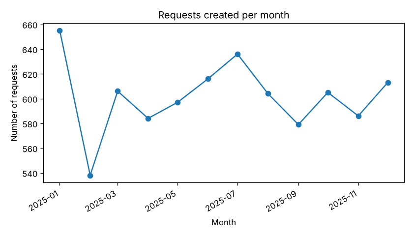

# Reproducible Data Pipeline & Tabular ML  (Name: <YOUR NAME> | Roll no: <YOUR ROLL NO>)

> **STATUS:** this repo currently runs on a SYNTHETIC demo dataset so the code can be tested.
> Replace it with your TA-approved real dataset (see "Switching to your real dataset") before submitting.

## Dataset
Source URL: <...> | Licence: <...> | Access date: <...> | Rows x columns: <...>
Target: `sla_breached` (request closed after 72 h). Why useful: <who would use the prediction and for what>.

## Setup and run (fresh clone)
```bash
python -m venv .venv && source .venv/bin/activate      # Windows: .venv\Scripts\activate
pip install -r requirements.txt
python -m src.make_demo_data        # DEMO ONLY - skip when using real data (put the file in data/raw/)
python -m src.inspect_schema        # writes docs/schema.md
python -m src.run_part_a            # Part A: validate, clean, summaries, charts, SQLite, metrics.json
python -m src.train                 # Part B: split, compare models, error analysis, save pipeline
python -m src.predict data/new_rows/new_rows.csv outputs/reports/predictions.csv
python -m src.demo_quality_gate     # Part A bonus: gate fails on corrupted copy, passes on real data
pytest -q                           # tests
python exploration/c1_feed_index.py # Part C1 experiment
```

## Part A findings
| Figure | What it shows (one sentence) |
|---|---|
|  | <write: which categories breach the SLA most> |
|  | <write: shape of resolution time> |
|  | <write: volume per month> |

SQL used (`sql/requests_by_category.sql`) and result (`outputs/reports/sql_requests_by_category.csv`): <explain the result>.
Data-quality report: `outputs/reports/metrics.json` (missing % before/after, duplicates removed, rows rejected, pass rate).

## Part B findings
Model comparison (cross-validated, training data only): `outputs/reports/model_comparison_cv.csv`.
Final test result (used once): `outputs/reports/test_results.json`. Error analysis: `misclassified_rows.csv`,
`subgroup_by_category.csv`, `fig4_confusion_matrix.png`. Feature importance: `permutation_importance.csv`.
Assumptions, limitations, intended use, risks (model card): `docs/assumptions.md`.

## Switching to your real dataset
1. Put the raw file in `data/raw/` (never edit it) and set `RAW_FILE` in `src/config.py`.
2. Update column lists, `RANGES`, `TARGET`, `LEAK_COLS`, `TASK` in `src/config.py`.
3. Edit `features.derive_columns` (how the target is created) and the SQL in `sql/`.
4. Re-run the commands above and rewrite the findings in this README in your own words.

## Tools used (required by the assignment)
AI assistant (Claude) was used to explain concepts and to generate a starter scaffold which I then read, changed
and tested. I can explain every line. <edit this honestly to match what you actually did>
